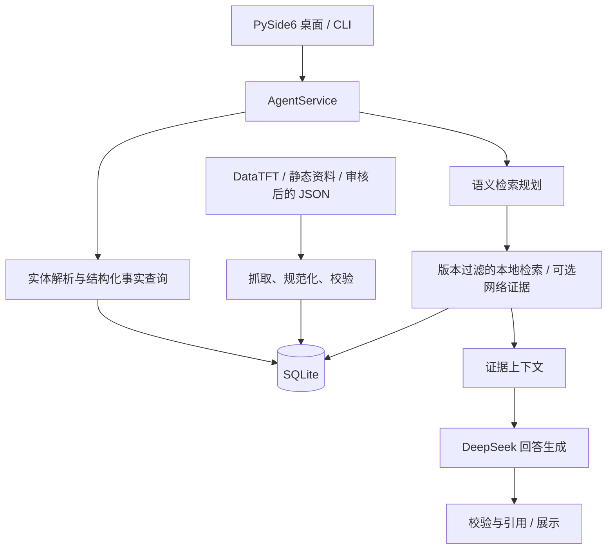

# TFT Decision Agent · 云顶之弈知识与决策助手

面向《云顶之弈》的 Python AI 应用原型，将自然语言问题、版本化游戏资料与可追溯证据结合，提供中文阵容查询和攻略问答。项目包含 PySide6 桌面客户端、CLI、数据同步管线及 MCP 工具接口，作为个人求职作品集展示 AI 应用工程实践。

项目重点是**检索与生成的分工、补丁版本隔离、证据引用和可测试的服务边界**。当前生产入口使用 `AgentService`；早期工具调用 Agent 与 MCP 集成保留用于兼容和回归。

## 核心功能

- **中文攻略问答**：解析目标、偏好、条件和实体，支持组合名称与多轮追问；检索规划失败时回退到本地检索。
- **结构化事实查询**：从 SQLite 查询阵容与基础资料，明确的事实浏览不需要 LLM 生成。
- **版本化知识管理**：保存补丁、来源、抓取时间和快照身份；完整校验后通过事务发布候选快照，失败保留历史。
- **可追溯回答**：攻略建议关联证据 ID，引用区分阵容、来源及快照；资料不足时说明缺口，不把来源评级当作胜率。
- **可选网络补充**：通过 Brave Search 发现链接，仅使用允许域名下符合版本与正文校验的文章；无搜索密钥时使用本地资料。
- **桌面交互**：中文聊天、阵容浏览、本地会话记录、截图选择与取消操作；应用运行期间协调周期性资料更新。
- **分层评测**：离线单元与集成测试，以及显式启用的真实模型评测，覆盖检索、版本生命周期、引用、状态处理与视觉边界。

## 技术架构



| 层次 | 实现与职责 |
| --- | --- |
| 界面 | PySide6、CLI；共享应用服务 |
| 应用编排 | `app/`：意图与实体解析、检索、会话范围、引用、更新协调 |
| 模型边界 | OpenAI-compatible SDK 接入 DeepSeek；Pydantic 校验数据契约 |
| 数据管线 | `ingestion/`：来源适配、规范化、快照校验与事务发布 |
| 存储 | SQLite：结构化资料、知识修订、快照与更新状态 |
| 工具与兼容 | `tft_mcp_server/`、`mcp_client/`、`agent/`：MCP 与早期 AgentRuntime |
| 工程与验证 | Python 3.12、uv、pytest、Ruff、mypy |

攻略主流程通常包含一次语义规划调用和一次回答调用；明确的事实查询走确定性路径。生产 CLI 和桌面入口不使用模型自主循环选择工具。`sentence-transformers` 与 embedding 模块用于保留的知识导入／检索实验，主问答检索不依赖向量数据库。

## 安装

需要 Python **3.12**、Git 和 uv。桌面启动脚本面向 Windows；其他系统可尝试 CLI，未在此声明桌面兼容性验证。

```powershell
git clone https://github.com/1244075201/TFT-Agent.git
cd TFT-Agent
uv sync --all-extras --frozen
Copy-Item .env.example .env
```

如已有 `.env`，保留现有文件。首次安装需要联网下载依赖。编辑本地 `.env`：

| 配置 | 用途 |
| --- | --- |
| `DEEPSEEK_API_KEY` | 模型问答密钥，填入你自己的凭据 |
| `TFT_AGENT_MODEL` / `DEEPSEEK_BASE_URL` | 模型名与兼容 API 地址；按账户实际可用服务配置 |
| `TFT_AGENT_KNOWLEDGE_SEARCH_API_KEY` | 可选 Brave Search 密钥，留空则不启用该搜索服务 |
| `TFT_AGENT_DATABASE_PATH` | 本地 SQLite 路径，默认 `data/tft.sqlite3` |
| `TFT_AGENT_DATA_REFRESH_ENABLED` | 桌面资料自动刷新；离线演示可设为 `false` |
| `TFT_AGENT_KNOWLEDGE_WEB_ENABLED` | 网络知识补充；离线演示可设为 `false` |

完整配置见 [`.env.example`](.env.example)。模板中的模型、赛季及版本是开发配置，不保证仍对应当前服务或实时游戏版本；不要仅改版本标签来复用旧数据。

## 数据准备与运行

仓库不包含本地数据库、聊天历史和抓取缓存。先选择一种资料导入方式。

**演示数据**：以下命令导入仓库自带的格式示例，只用于验证导入流程；其中阵容和统计数值是占位示例，不代表真实强度。

```powershell
uv run tft-sync-datatft --input data_sources/datatft_snapshot.example.json
```

**实际资料**：导入自己审核过、带准确补丁标识的 canonical JSON，格式参考上述示例；或运行在线同步。来源站点变化可能使在线同步失败。

```powershell
# 在线获取并校验 DataTFT 快照
uv run tft-sync-datatft

# 按配置导入 CommunityDragon 静态资料
uv run tft-sync-static-data

# 导入仓库附带的历史商店概率快照
uv run tft-sync-shop-odds
```

静态资料与商店概率均有自己的来源版本，必须与演示目标核对；旧快照不会自动成为当前版本事实。初始化后的有效补丁由数据库版本注册表管理。

启动中文桌面客户端：

```powershell
uv run tft-agent-desktop
```

Windows 首次安装后也可双击 `启动云顶指导Agent.cmd`。CLI 入口会提示输入一个问题：

```powershell
uv run tft-agent
```

可尝试“这个版本有哪些阵容”或针对已导入阵容提问。结果取决于本地证据覆盖范围与有效版本；生成式问答需要可用模型密钥，并可能产生 API 费用。截图提取还需要单独配置可用的视觉模型。

## 测试与评测

```powershell
# 离线回归，排除真实模型测试
uv run pytest -m "not real_llm"
uv run ruff check src tests
uv run mypy src

# 可选：真实模型攻略理解评测，会调用付费服务
uv run tft-eval-guide-understanding --limit 10
```

2026-10-18 本地发布检查：Ruff 通过，mypy 检查 108 个源文件通过；上述离线回归为 **417 passed、12 failed、6 deselected**，并非全绿。失败集中在 `test_query_understanding_polish.py`、`test_retrieval_first_strategy.py` 和 `test_retrieval_quality.py` 的实体解析、阵容候选与上下文断言。本次发布未修改核心代码。

部分回归 fixture 会复制本地 `data/tft.sqlite3`，并依赖特定阵容内容；仓库不分发该数据库。因此，全量回归不是开箱即用的独立测试集，新克隆环境需准备对应数据，导入格式示例不能代替测试所需快照。此处结果仅代表本次本地环境，尚未确认失败属于数据变化还是实现问题。

评测用例位于 `evals/`，运行产物写入被 Git 忽略的 `eval_results/`。结构契约通过率不等于策略正确率；合成截图测试不等于真实游戏视觉准确率。历史验证见 [每日更新与引用验证](docs/data-update-validation-2026-09-22.md) 和 [攻略联调记录](docs/guide-validation-2026-09-22.md)，其结果仅对应记录时的版本与环境。

## 目录结构

```text
src/tft_agent/
  app/                 应用服务、检索、引用、更新协调
  core/                配置、数据模型、补丁与证据契约
  desktop/             PySide6 桌面界面
  ingestion/           数据来源适配、导入与同步
  llm/                 模型调用与事实约束
  tft_mcp_server/       MCP 工具与 SQLite 仓储
  mcp_client/          MCP 客户端
  agent/               早期 AgentRuntime 与校验逻辑
  vision/、screen/     图像观察与实验性监控
  embeddings/、evals/  检索实验与评测入口
data_sources/          版本化样例、别名与审核数据
tests/                 自动化测试
evals/                 评测用例与合成图像
docs/                  设计历史及验证记录
```

## 项目边界

这是知识问答与 AI 工程展示原型，非 Riot 官方产品。实验性实时监控默认关闭，截图模块只观察像素，不读取游戏内存、不注入客户端、不自动操作游戏；作品集演示使用资料查询、离线样例和手动输入。实时辅助能力的使用与分发需遵守游戏服务方要求。

外部来源不保证稳定或完整；未核验的服务器版本、缺失证据与统计字段会保留不确定状态。当前未提供全量元数据覆盖、长期规划或真实截图准确率承诺。

密钥仅放在本地 `.env`；数据库、聊天历史、日志、缓存、虚拟环境和评测运行结果不进入版本控制。更详细的历史设计与旧版评测入口见 [架构与迭代记录](docs/architecture-and-history.md)。
